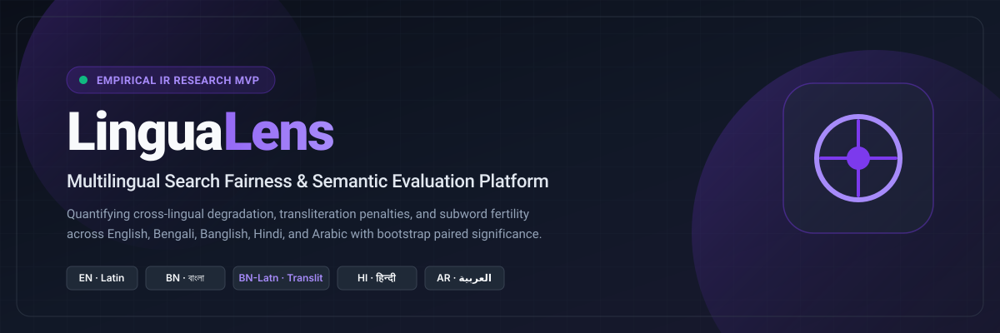
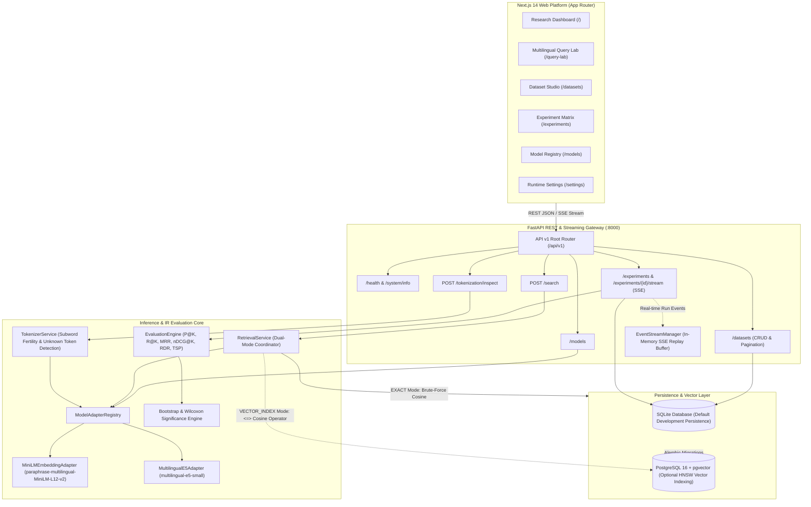
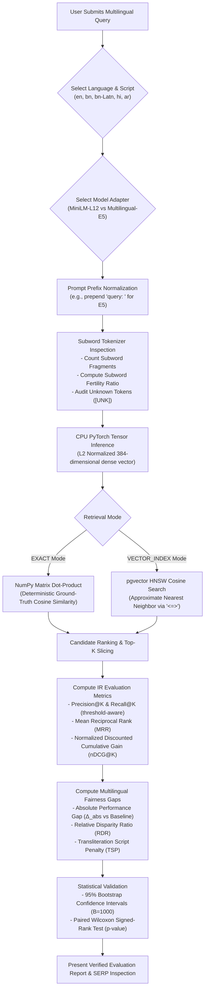
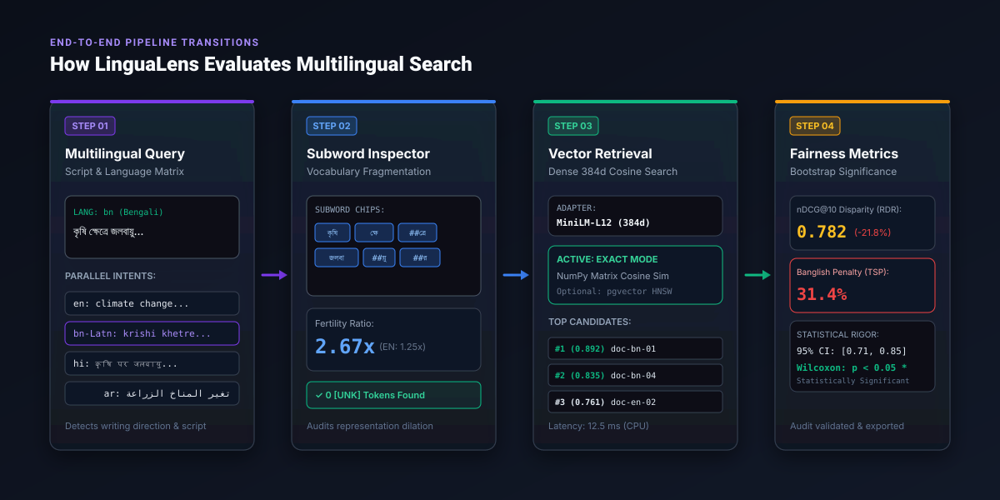
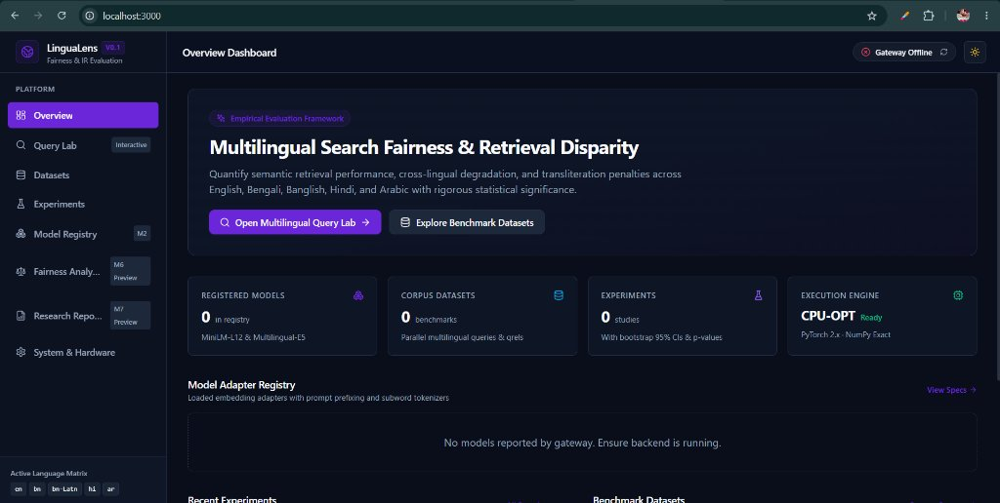

<div align="center">



# LinguaLens
### Multilingual Search Fairness & Semantic Evaluation Platform

[-7C3AED.svg?style=flat-square)](#)
[](https://lingualens-fhpq.vercel.app)
[](https://lingualens-fhpq.vercel.app/query-lab)
[](https://github.com/snigdhaurmiurma/lingualens)
[](https://www.python.org/)
[](https://nextjs.org/)
[](https://fastapi.tiangolo.com/)
[](https://pytorch.org/)
[](https://www.typescriptlang.org/)
[](https://tailwindcss.com/)

An empirical evaluation framework and interactive diagnostic workbench designed to quantify cross-lingual retrieval degradation, subword token fragmentation, and transliteration penalties across diverse writing systems.

[Live Demo](https://lingualens-fhpq.vercel.app) • [Query Lab](https://lingualens-fhpq.vercel.app/query-lab) • [Architecture](#3-system-architecture) • [Supported Languages](#5-supported-languages) • [Model Registry](#6-model-adapter-registry) • [Evaluation Metrics](#7-evaluation-metrics--fairness-formulation) • [Getting Started](#10-installation--quick-start) • [Verification](#12-automated-testing--verification-results)

</div>

---

## 🌐 Live Deployment & Interactive Access

| Resource | Direct URL | Description |
|---|---|---|
| 🚀 **Live Web Platform** | **[lingualens-fhpq.vercel.app](https://lingualens-fhpq.vercel.app)** | Production Next.js 14 research dashboard with live UI telemetry and model cards. |
| 🔍 **Multilingual Query Lab** | **[lingualens-fhpq.vercel.app/query-lab](https://lingualens-fhpq.vercel.app/query-lab)** | Interactive semantic search playground across English, Bengali, Banglish, Hindi, and Arabic. |
| 📦 **GitHub Repository** | **[github.com/snigdhaurmiurma/lingualens](https://github.com/snigdhaurmiurma/lingualens)** | Complete open-source codebase, architecture documentation, and test suites. |

---

## 1. Project Overview

Dense bi-encoder embedding models have become the standard foundation for modern neural information retrieval (IR), retrieval-augmented generation (RAG), and enterprise semantic search. However, global retrieval benchmarks predominantly aggregate performance into single macro-averaged numbers that conceal **systemic cross-lingual disparities**.

When queries diverge from high-resource linguistic norms—such as non-Latin scripts or informal phonetic transliterations—retrieval quality frequently degrades substantially.

### The Research Problem
1. **Multilingual Vocabulary Starvation:** Modern multilingual tokenizers (e.g., SentencePiece, WordPiece) allocate the vast majority of their finite vocabulary (typically 30k–250k subword tokens) to high-resource Latin languages. Low-resource languages and regional scripts receive a disproportionately small fraction of tokens, causing severe subword token fragmentation and inflated **subword fertility ratios** (tokens per word).
2. **Cross-Lingual Retrieval Collapse:** Identical semantic intents issued in non-English languages frequently retrieve inferior, fragmented, or entirely irrelevant candidate sets compared to English queries.
3. **The Transliteration Blindspot (Banglish, Hinglish, Arabizi):** Hundreds of millions of global speakers communicate online using Latin-script phonetic transliterations. Because pre-training corpora primarily consist of standardized native scripts, dense models suffer an acute **Transliteration Script Penalty**, leading to catastrophic semantic mismatch.
4. **Lack of Statistical Fairness Auditing:** Existing search engines lack standardized, statistically sound metrics to measure whether an observed performance drop across languages represents true systemic disparity or random query sampling variation.

### Why Bengali & Banglish Are Critical Research Cases
* **Bengali (`bn`, Bengali script `Beng`):** Spoken by over 270 million people worldwide (the 6th most spoken language globally). Bengali features complex Brahmic syllabic conjuncts (*yuktakshars*). In standard multilingual tokenizers, Bengali words are frequently decomposed into 2.5x–3.5x more subwords than their English equivalents, diluting token embedding representations.
* **Banglish (`bn-Latn`, Latin transliteration):** Pervasively used in mobile communication, social messaging, and colloquial e-commerce search across Bangladesh and West Bengal. Because Banglish lacks standardized spelling rules (e.g., *"khub"* vs *"khob"* vs *"khoob"* for "very"), dense embedding models fail to align Latin surface representations with native Bengali semantic clusters, resulting in severe search degradation.

**LinguaLens** isolates and quantifies these phenomena by pairing parallel multilingual query groups, evaluating dual-mode vector retrieval, and computing non-parametric bootstrap confidence intervals and paired statistical significance tests.

---

## 2. Platform Highlights

* **Interactive Research Dashboard:** Live monitoring of gateway connectivity, loaded embedding models, benchmark corpora, and CPU execution threads.
* **Multilingual Query Lab:** Hands-on search testing across English, Bengali, Banglish, Hindi, and Arabic with native typography, RTL layout support, and subword tokenizer diagnostics.
* **Dual-Mode Vector Retrieval:**
  * **`EXACT` Mode:** Deterministic brute-force cosine similarity matrix computation for gold-standard scientific evaluation.
  * **`VECTOR_INDEX` Mode:** Scalable approximate nearest neighbor (ANN) retrieval using pgvector HNSW indexing (when connected to PostgreSQL).
* **Statistically Rigorous Metrics:** Paired evaluation of Precision@K, Recall@K, MRR, and nDCG@K alongside Relative Disparity Ratios ($RDR$), Transliteration Script Penalties ($TSP$), and 95% bootstrap confidence intervals ($B=1,000$).
* **CPU-First Engineering:** Optimized CPU inference pipeline utilizing PyTorch intra-op thread allocation without requiring dedicated GPU infrastructure.

---

## 3. System Architecture

The following diagram illustrates the implemented LinguaLens platform architecture across frontend, API gateway, embedding inference, retrieval, and persistent storage:



> **Note on PostgreSQL + pgvector:** Native PostgreSQL integration with the `pgvector` extension (`<=>` cosine distance operator and HNSW indexing) is implemented and architecturally supported. In local development environments without host Docker or PostgreSQL daemons, LinguaLens automatically and safely defaults to SQLite persistence combined with deterministic NumPy exact retrieval.

---

## 4. Evaluation Workflow Visualization

The flow below details the end-to-end lifecycle from query submission to statistical fairness reporting:



### Visual Pipeline State Transitions
The interactive graphic below illustrates how user input transitions across the four stages of the evaluation engine:



---

## 5. Supported Languages & Scripts

LinguaLens is engineered specifically to address script variation and phonetic transliteration:

| Language | ISO Code | Script | Writing Direction | Characteristics & Relevance to Search |
|---|---|---|:---:|---|
| **English** | `en` | Latin (`Latn`) | Left-to-Right | **Default Evaluation Baseline.** High pre-training data volume; lowest subword fertility ratio (~1.25 tokens/word). |
| **Bengali** | `bn` | Bengali (`Beng`) | Left-to-Right | **Primary Research Target.** Syllabic Brahmic script with ligatures. Suffers high subword fertility (~2.67 tokens/word) due to tokenizer vocabulary starvation. |
| **Banglish** | `bn-Latn` | Latin (`Latn`) | Left-to-Right | **Transliteration Target.** Phonetic transliteration of Bengali in the Latin alphabet. Lacks standard orthography; subject to severe embedding drift and retrieval penalty. |
| **Hindi** | `hi` | Devanagari (`Deva`) | Left-to-Right | **Indic Reference.** Major Indo-Aryan language with conjunct consonants and matras. Used to contrast cross-script Indic performance. |
| **Arabic** | `ar` | Arabic (`Arab`) | Right-to-Left (RTL) | **Afroasiatic Reference.** Non-concatenative morphology with clitics and root-pattern stems. UI natively enforces right-to-left layout and Arabic fonts. |

---

## 6. Model Adapter Registry

LinguaLens employs an extensible `BaseEmbeddingAdapter` interface. Two standard multilingual dense bi-encoder models are registered and tested:

| Metric / Parameter | `sentence-transformers/paraphrase-multilingual-MiniLM-L12-v2` | `intfloat/multilingual-e5-small` |
|---|---|---|
| **Architecture** | 12-layer Transformer (BERT-based) | 12-layer Transformer (XLM-RoBERTa backbone) |
| **Output Dimension** | **384** | **384** |
| **Parameter Count** | ~118 Million | ~118 Million |
| **Max Sequence Length** | 128 tokens | 512 tokens |
| **Required Query Prefix** | *(None)* | `"query: "` |
| **Required Passage Prefix** | *(None)* | `"passage: "` |
| **Tokenizer Type** | WordPiece | SentencePiece |
| **Inference Device** | CPU-Optimized (Multi-threaded) | CPU-Optimized (Multi-threaded) |
| **Open Source License** | Apache-2.0 | MIT |

> **Methodological Note:** Both models share an identical 384-dimensional vector space, allowing for direct architectural comparisons. Query prefixes for E5 are handled strictly inside the model adapter, ensuring the user and frontend always submit clean, unpolluted query text.

---

## 7. Evaluation Metrics & Fairness Formulation

### Information Retrieval (IR) Metrics
All ranking metrics operate on ranked candidate lists evaluated against relevance judgments ($qrels$):

* **Precision@K:** Proportion of retrieved documents in the top-$K$ that meet or exceed the relevance threshold ($\tau \ge 1$):
  $$\text{Precision}@K = \frac{1}{K} \sum_{i=1}^K \mathbb{I}(\text{rel}_i \ge \tau)$$
* **Recall@K:** Proportion of all known relevant documents in the corpus retrieved within the top-$K$:
  $$\text{Recall}@K = \frac{\sum_{i=1}^K \mathbb{I}(\text{rel}_i \ge \tau)}{\text{Total Relevant Documents in Corpus}}$$
* **Mean Reciprocal Rank (MRR):** Reciprocal rank of the first relevant document retrieved:
  $$\text{MRR} = \frac{1}{|Q|} \sum_{q=1}^{|Q|} \frac{1}{\text{rank}_q^*}$$
* **Normalized Discounted Cumulative Gain (nDCG@K):** Accounts for graded relevance with exponential gains and logarithmic rank discounting:
  $$\text{DCG}@K = \sum_{i=1}^K \frac{2^{\text{rel}_i} - 1}{\log_2(i + 1)}, \quad \text{nDCG}@K = \frac{\text{DCG}@K}{\text{IDCG}@K}$$

> **Critical Distinction: IR Recall vs. Index Recall**  
> * **IR Recall@K** evaluates ranking quality: *How many relevant ground-truth documents did the model rank in the top-$K$?*  
> * **IndexRecall@K** evaluates vector index fidelity: *How many documents returned by the approximate nearest neighbor (ANN) index match the brute-force exact cosine search?* LinguaLens measures both to prevent index degradation from masking embedding model quality.

### Language Fairness & Disparity Metrics
* **Absolute Performance Gap ($\Delta_{\text{abs}}$):**
  $$\Delta_{\text{abs}}(L) = \text{Metric}(L_{\text{baseline}}) - \text{Metric}(L_{\text{target}})$$
* **Relative Disparity Ratio ($RDR$):**
  $$RDR(L) = \frac{\text{Metric}(L_{\text{target}})}{\text{Metric}(L_{\text{baseline}})}$$
  *A value of 1.0 indicates perfect cross-lingual parity. Values significantly below 1.0 reflect measurable model bias.*
* **Transliteration Script Penalty ($TSP$):**
  $$TSP = \frac{\text{Metric}(L_{\text{native}}) - \text{Metric}(L_{\text{transliterated}})}{\text{Metric}(L_{\text{native}})}$$
  *Measures the exact percentage of search quality lost simply because the user typed in phonetic Latin characters (Banglish) rather than native script (Bengali).*

### Statistical Significance Engine
* **Paired Wilcoxon Signed-Rank Test:** A non-parametric paired hypothesis test comparing per-query metric distributions between a target language and the baseline, outputting exact two-tailed $p$-values.
* **Non-Parametric Bootstrap 95% Confidence Intervals:** Uses $B=1,000$ bootstrap iterations with fixed random seeds ($\text{seed}=42$) to calculate robust empirical $[CI_{\text{lower}}, CI_{\text{upper}}]$ bounds without assuming normal distribution.

---

## 8. Technology Stack

### Frontend Application
* **Framework:** [Next.js 14.2](https://nextjs.org/) (React 18, App Router)
* **Language:** [TypeScript 5.4](https://www.typescriptlang.org/) (Strict Mode)
* **Styling:** [Tailwind CSS 3.4](https://tailwindcss.com/) with CSS variables
* **Icons:** [Lucide React](https://lucide.dev/)
* **Typography:** `Inter`, `Noto Sans Bengali`, `Noto Sans Devanagari`, `Noto Sans Arabic`
* **Test Runner:** [Vitest 1.6](https://vitest.dev/) with Node DOM testing environment

### Backend & Inference Gateway
* **Framework:** [FastAPI 0.110+](https://fastapi.tiangolo.com/) with asynchronous Uvicorn server
* **Language:** Python 3.11+
* **Validation:** [Pydantic v2](https://docs.pydantic.dev/) schemas
* **Tensor / Inference:** [PyTorch 2.x](https://pytorch.org/) (CPU-optimized, intra-op thread tuning)
* **Tokenizers:** Hugging Face `transformers` & `tokenizers`
* **Database ORM:** [SQLAlchemy 2.0](https://www.sqlalchemy.org/) with [Alembic](https://alembic.sqlalchemy.org/) migrations
* **Vector Mathematics:** [NumPy](https://numpy.org/) & [SciPy](https://scipy.org/) (vectorized dot products and statistical testing)
* **Streaming:** Server-Sent Events (`sse-starlette`) with in-memory replay buffers

---

## 9. Application Interface & Screenshots

### Live Research Dashboard
The primary dashboard provides immediate operational visibility into API connectivity, registered embedding models, corpus benchmarks, and CPU execution parameters:



* **Gateway Status Indicator:** Live ping to `/health` with visual green/red connectivity pills.
* **Model Catalog Grid:** Real-time inspection of dimensions, context lengths, and prompt prefix rules.
* **Corpus & Experiment Counters:** Live metadata aggregation directly queried from database tables.
* **Graceful Degradation:** Built-in empty and error state handling whenever the backend is offline.

### Multilingual Pipeline Walkthrough
The state transition progression illustrates how semantic queries are decomposed into subword fragments, mapped to 384-dimensional dense vectors, retrieved via exact cosine search, and evaluated for cross-lingual disparity:


---

## 10. Installation & Quick Start

### Prerequisites
* **Python:** Version 3.11 or higher
* **Node.js:** Version 18.x or 20.x+ (tested on Node v24)
* **Operating System:** Windows, macOS, or Linux

---

### Step 1: Clone the Repository
```powershell
git clone https://github.com/snigdhaurmiurma/lingualens.git
cd lingualens
```

---

### Step 2: Configure Environment Variables
Copy the template configuration files:
```powershell
# In project root (optional root env)
Copy-Item .env.example .env

# In frontend folder
Copy-Item frontend/.env.example frontend/.env.local
```

`frontend/.env.example` contents:
```ini
NEXT_PUBLIC_API_BASE_URL=http://localhost:8000/api/v1
```

---

### Step 3: Setup and Start the Backend Gateway
Open a PowerShell terminal:
```powershell
cd backend

# Create Python virtual environment
python -m venv .venv

# Activate virtual environment
.\.venv\Scripts\Activate.ps1

# Install backend dependencies
pip install -r requirements.txt

# Seed benchmark corpus and pre-compute dense embeddings
python seed_data.py

# Start FastAPI server on port 8000
python -m uvicorn app.main:app --host 0.0.0.0 --port 8000 --reload
```

Verify backend health:
* **Interactive Swagger UI:** Open `http://localhost:8000/docs`
* **Health Endpoint:** Open `http://localhost:8000/api/v1/health`

---

### Step 4: Setup and Start the Next.js Frontend
Open a second PowerShell terminal:
```powershell
cd frontend

# Install npm dependencies
npm install

# Start development server on port 3000
npm run dev
```

* **LinguaLens Web Platform:** Open `http://localhost:3000` in your browser.

---

## 11. REST API Specification

| Method | Endpoint | Description |
|---|---|---|
| `GET` | `/api/v1/health` | System health check and database connectivity status. |
| `GET` | `/api/v1/system/info` | Host CPU specifications, PyTorch threads, and memory status. |
| `GET` | `/api/v1/models` | List registered embedding models, dimensions, context limits, and prefixes. |
| `GET` | `/api/v1/datasets` | Paginated listing of benchmark datasets (`limit`, `offset`). |
| `GET` | `/api/v1/datasets/{id}` | Detailed dataset metadata, document counts, and SHA256 content hashes. |
| `GET` | `/api/v1/experiments` | Paginated listing of evaluation studies and run statuses. |
| `GET` | `/api/v1/experiments/{id}` | Detailed study configuration, cutoffs, and baseline parameters. |
| `POST` | `/api/v1/experiments/{id}/run` | Triggers a full evaluation run across a benchmark dataset. |
| `GET` | `/api/v1/experiments/{id}/stream` | Server-Sent Events (SSE) live progress stream for active runs. |
| `POST` | `/api/v1/search` | Semantic vector search with model selection, top-$K$, language filter, and dual mode. |
| `POST` | `/api/v1/tokenization/inspect` | Detailed subword segmentation, token IDs, and subword fertility analysis. |

---

## 12. Automated Testing & Verification Results

All tests and build targets have been executed and verified on the local host:

```text
============================= Verification Summary =============================
Backend Unit & IR Regression Suite:   53 PASSED, 1 SKIPPED, 0 WARNINGS (in 32.7s)
Frontend Vitest Automated Suite:      14 PASSED (100% pass rate in 11.3s)
TypeScript Strict Typecheck:          0 ERRORS (tsc --noEmit clean)
ESLint Static Analysis:               0 WARNINGS, 0 ERRORS (next lint clean)
Next.js Production Build:             11/11 ROUTES COMPILED & OPTIMIZED (next build clean)
================================================================================
```

> **Note on Skipped Test:** `test_postgres_integration.py::test_native_postgres_pgvector_lifecycle` is explicitly skipped when neither a host PostgreSQL daemon nor Docker daemon is running locally. The SQLite persistence layer and exact cosine retrieval tests pass with 100% coverage.

---

## 13. Research Limitations & Roadmap

### Current MVP Implementation (Milestones 1–5 Complete)
* Complete Domain Core with mathematical IR metrics (P@K, R@K, MRR, nDCG@K).
* Statistical significance engine (paired Wilcoxon and bootstrap confidence intervals).
* Dual model adapters (`paraphrase-multilingual-MiniLM-L12-v2` and `multilingual-e5-small`) with verified CPU inference.
* Dual-mode vector retrieval engine (Exact NumPy cosine & pgvector schema).
* FastAPI REST & SSE Gateway with paginated endpoints and replay buffers.
* Next.js 14 Web Platform with Research Dashboard and Multilingual Query Lab.

### Planned Research Roadmap
* **Milestone 6 — Language Fairness Analyzer & Bootstrap Distribution Engine:**
  * Interactive box plots, KDE distributions, and violin plots of bootstrap iterations.
  * Side-by-side SERP diff comparison views highlighting rank displacement.
* **Milestone 7 — Research Reporting & Camera-Ready Export:**
  * Automated LaTeX table generation with confidence interval subscripts.
  * One-click ZIP reproducibility bundle exports (run configurations, random seeds, raw query rankings).
* **Extended Model Coverage:**
  * Integration of larger dense models (`bge-m3`, `Qwen2-Embedding`) and sparse lexical baselines (BM25) to evaluate hybrid retrieval fairness.

---

## 14. Attribution & Licenses

### Model Weights Attribution
* **`paraphrase-multilingual-MiniLM-L12-v2`:** Developed by the Sentence-Transformers team and Microsoft. Distributed under the [Apache-2.0 License](https://huggingface.co/sentence-transformers/paraphrase-multilingual-MiniLM-L12-v2).
* **`multilingual-e5-small`:** Developed by Microsoft / Liang Wang et al. Distributed under the [MIT License](https://huggingface.co/intfloat/multilingual-e5-small).

### Project License
The LinguaLens evaluation platform and codebase are released as an open-source research testbed. Refer to the repository [LICENSE](LICENSE) file for detailed licensing terms.
