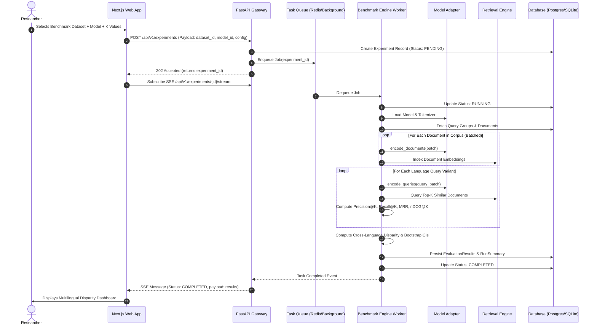

# LinguaLens: System Architecture & Technical Design

**Document Version:** 1.0.0  
**Status:** Approved Architecture Baseline  
**Date:** November 2026  

---

## 1. Architectural Principles

LinguaLens adheres to **Clean Architecture** (Ports and Adapters / Hexagonal pattern) combined with domain-driven modularity. The design enforces strict separation of concerns to achieve three non-negotiable qualities:

1. **Framework Independence:** Core ML evaluation logic and statistical algorithms do not depend on FastAPI, SQLAlchemy, or Next.js. They reside in pure Python domain modules.
2. **Execution Portability:** The system runs in two operational profiles:
   - **Full Scaled Profile:** PostgreSQL with `pgvector` + Redis queue + Celery distributed workers + Docker.
   - **Zero-Dependency Lightweight Profile:** Embedded SQLite + In-Memory NumPy / FAISS vector retriever + FastAPI asynchronous BackgroundTasks. This ensures instant setup on any local workstation without mandatory container daemons.
3. **Scientific Reproducibility:** Every evaluation outcome is an immutable snapshot linking:
   $$\text{Run ID} \implies (\text{Dataset Hash}, \text{Model Revision}, \text{Hardware Metadata}, \text{Random Seed}, \text{Metric Set})$$

---

## 2. High-Level System Architecture

```mermaid
flowchart TD
    subgraph UI ["Frontend Presentation (Next.js 14+ App Router)"]
        Dashboard["Evaluation Dashboard"]
        Lab["Multilingual Query Lab"]
        Bench["Model Benchmarker"]
        Fairness["Fairness Analyzer"]
        DataStudio["Dataset Studio"]
        ReportGen["Report Generator"]
    end

    subgraph Gateway ["API & Orchestration Layer (FastAPI)"]
        Router["REST / SSE Endpoints"]
        Validator["Pydantic v2 Schemas"]
        AuthMiddleware["Security & Auth Middleware"]
        JobManager["Experiment Job Scheduler"]
    end

    subgraph CoreEngine ["Domain & Business Logic Layer"]
        ModelAdapterSystem["Model Adapter Registry"]
        RetrievalEngine["Dense Retrieval Engine"]
        EvalEngine["IR Evaluation Engine (nDCG, MRR, P@K, R@K)"]
        FairnessEngine["Fairness & Disparity Analyzer"]
        StatsEngine["Bootstrap & Significance Engine"]
    end

    subgraph Workers ["Asynchronous Workers"]
        WorkerQueue["Redis Broker / Async Task Queue"]
        CeleryWorker["Celery / Async Task Worker"]
    end

    subgraph Storage ["Persistence & Vector Layer"]
        RelationalDB[("PostgreSQL / SQLite")]
        VectorStore[("pgvector / NumPy Matrix / FAISS")]
        FileStore[("Dataset Artifact Store (.jsonl, .parquet)")]
    end

    UI -->|HTTP / JSON / EventStream| Router
    Router --> Validator
    Validator --> AuthMiddleware
    AuthMiddleware --> JobManager
    JobManager -->|Enqueue Batch Task| WorkerQueue
    WorkerQueue --> CeleryWorker
    CeleryWorker --> CoreEngine
    JobManager -->|Direct Synchronous Path (Query Lab)| CoreEngine

    CoreEngine --> ModelAdapterSystem
    CoreEngine --> RetrievalEngine
    CoreEngine --> EvalEngine
    CoreEngine --> FairnessEngine
    CoreEngine --> StatsEngine

    RetrievalEngine --> VectorStore
    JobManager --> RelationalDB
    CeleryWorker --> RelationalDB
    DataStudio --> FileStore
```

---

## 3. Subsystem Decomposition & Boundaries

### 3.1 Frontend Presentation (`frontend/`)
- **Tech Stack:** Next.js 14+ (App Router), TypeScript (Strict Mode), Tailwind CSS, shadcn/ui (Radix Primitives), Lucide Icons, Recharts.
- **Responsibilities:**
  - Responsive, accessible dashboard rendering with a clean, high-contrast palette: **Deep Midnight Navy (`#0A0F1D`)**, **Clean Slate (`#F8FAFC`)**, and **Electric Violet (`#7C3AED`)** accents.
  - Interactive multi-SERP comparison visualization with synchronous scrolling and rank-delta callouts.
  - Dynamic tokenization inspector rendering subword boundary chips with token IDs.
  - Tabular and visual display of 95% bootstrap confidence intervals and statistical significance flags ($p < 0.05$).
- **Boundaries:** Zero business logic or mathematical calculations. Consumes typed API clients generated from OpenAPI schema.

### 3.2 API & Ingestion Layer (`backend/app/api/`)
- **Tech Stack:** FastAPI, Pydantic v2, Starlette.
- **Responsibilities:**
  - Route routing, parameter coercion, and strict schema validation.
  - File upload streaming and multipart validation (file magic bytes, MIME types, CSV/JSONL parsing).
  - Server-Sent Events (SSE) streaming for long-running batch benchmark progress updates.
- **Boundaries:** No direct database SQL or PyTorch calls inside route handlers; all calls dispatch to Service Layer entities.

### 3.3 Domain Services & ML Core (`backend/app/services/` & `adapters/`)
- **Model Adapter Pattern:**
  A uniform interface isolating differences across model families:
  ```python
  class BaseEmbeddingAdapter(ABC):
      @abstractmethod
      def encode_queries(self, queries: list[str]) -> np.ndarray:
          """Encode queries with any required task prefix."""
          pass

      @abstractmethod
      def encode_documents(self, documents: list[str]) -> np.ndarray:
          """Encode corpus passages with document prefix if required."""
          pass

      @abstractmethod
      def get_model_metadata(self) -> ModelMetadata:
          """Return parameter count, dimensions, license, and context window."""
          pass
  ```
- **Retrieval Engine:**
  - Performs nearest neighbor search (Cosine Similarity or Inner Product on normalized vectors).
  - Implements abstract backend: `PgVectorRetriever` for production database search, and `NumPyRetriever` for high-speed in-memory vector matrix arithmetic ($Q \cdot D^T$).
- **Evaluation & Fairness Engine:**
  - Computes standard IR metrics with graded relevance: $P@K, R@K, \text{MRR}, \text{nDCG}@K$.
  - Computes inter-language disparity metrics ($\Delta_{abs}, D_{rel}$).
  - Executes non-parametric bootstrap resampling ($B = 1000$) to yield empirical 95% confidence intervals $[CI_{low}, CI_{high}]$.

### 3.4 Data Persistence & Migration (`backend/app/models/` & `alembic/`)
- **Tech Stack:** SQLAlchemy 2.0 (declarative async/sync mapped models), Alembic.
- **Schema Separation:** Relational operational data (experiments, queries, runs) vs. Vector embeddings vs. Large corpus text files.

---

## 4. End-to-End Evaluation Workflow

The following sequence diagram illustrates an asynchronous benchmark run:



---

## 5. Security & Data Integrity

1. **Model Safety & Execution Boundary:** Only models pre-registered in the Model Registry or verified from trusted Hugging Face Hub repositories can be instantiated. Arbitrary remote code execution via pickle or unsanitized weights loading is strictly disabled (`trust_remote_code=False` by default).
2. **Dataset File Sanitization:** Dataset uploads are scanned for malicious byte sequences, parsed within memory thresholds, and persisted with cryptographically hashed names.
3. **Audit Trail:** Experiments are immutable once marked `COMPLETED`. No modification of past results is permitted; updates require initiating a new experiment run.
4. **Environment Isolation:** Runtimes record OS version, Python version, PyTorch version, and hardware accelerator flags alongside benchmark results to ensure forensic auditability.
