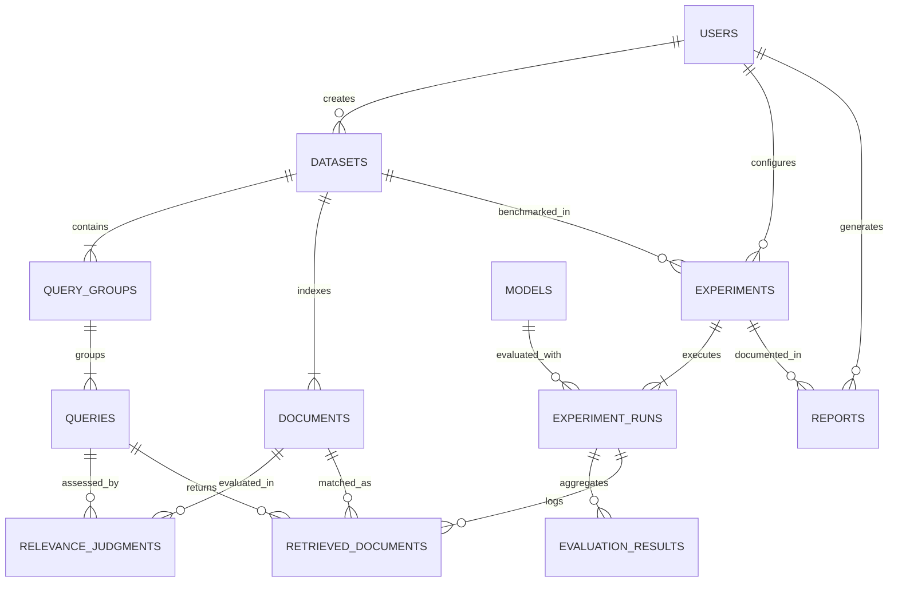

# LinguaLens: Database Design & Schema Specification

**Document Version:** 1.0.0  
**Status:** Approved Schema Specification  
**Date:** November 2026  

---

## 1. Schema Overview & Design Rationale

The LinguaLens database schema is structured to ensure:
1. **Scientific Traceability:** Every metric trace is auditable down to individual query-document pairs, rank positions, and similarity scores.
2. **Semantic Intent Grouping:** Queries in different languages/scripts that express the identical information need are linked via `query_groups`.
3. **Immutability of Runs:** Once an experiment run reaches `COMPLETED`, its parameters and recorded outputs are locked from modification.
4. **Storage Tiering:** Raw corpus texts and high-dimensional vector embeddings are cleanly decoupled from transactional evaluation aggregates.

---

## 2. Entity-Relationship (ER) Diagram



---

## 3. Detailed Entity Definitions & Constraints

### 3.1 `users`
Represents researchers, developers, or system service accounts.
- `id` (UUID, Primary Key)
- `email` (VARCHAR(255), Unique, Not Null)
- `hashed_password` (VARCHAR(255), Not Null)
- `full_name` (VARCHAR(150), Nullable)
- `role` (VARCHAR(50), Default: `'RESEARCHER'`) -- `ADMIN`, `RESEARCHER`, `AUDITOR`, `VIEWER`
- `is_active` (BOOLEAN, Default: `TRUE`)
- `created_at` (TIMESTAMPTZ, Default: `CURRENT_TIMESTAMP`)
- `updated_at` (TIMESTAMPTZ, Default: `CURRENT_TIMESTAMP`)

### 3.2 `datasets`
Represents an immutable versioned evaluation collection containing documents, queries, and relevance judgments.
- `id` (UUID, Primary Key)
- `name` (VARCHAR(150), Not Null)
- `slug` (VARCHAR(160), Unique, Not Null)
- `description` (TEXT, Nullable)
- `version` (VARCHAR(30), Not Null) -- e.g., `'1.0.0'`
- `dataset_type` (VARCHAR(40), Not Null) -- `'VALIDATED_BENCHMARK'` or `'DEMONSTRATION'`
- `license` (VARCHAR(100), Default: `'CC-BY-4.0'`)
- `source_uri` (VARCHAR(500), Nullable)
- `document_count` (INTEGER, Default: 0)
- `query_count` (INTEGER, Default: 0)
- `query_group_count` (INTEGER, Default: 0)
- `supported_languages` (JSONB / TEXT, Not Null) -- e.g., `["en", "bn", "bn-Latn", "hi", "ar"]`
- `content_hash_sha256` (VARCHAR(64), Not Null) -- cryptographic hash of raw data
- `is_locked` (BOOLEAN, Default: `TRUE`)
- `created_by_user_id` (UUID, Foreign Key -> `users.id`, ON DELETE SET NULL)
- `created_at` (TIMESTAMPTZ, Default: `CURRENT_TIMESTAMP`)

### 3.3 `query_groups`
Represents a singular cross-lingual semantic intent (e.g., "What are the health benefits of green tea?").
- `id` (UUID, Primary Key)
- `dataset_id` (UUID, Foreign Key -> `datasets.id`, ON DELETE CASCADE, Not Null)
- `canonical_intent` (TEXT, Not Null) -- English or canonical description of the intent
- `domain` (VARCHAR(100), Default: `'general'`) -- e.g., `'healthcare'`, `'legal'`, `'science'`
- `created_at` (TIMESTAMPTZ, Default: `CURRENT_TIMESTAMP`)

### 3.4 `queries`
A specific language and script surface realization of a query group.
- `id` (UUID, Primary Key)
- `query_group_id` (UUID, Foreign Key -> `query_groups.id`, ON DELETE CASCADE, Not Null)
- `dataset_id` (UUID, Foreign Key -> `datasets.id`, ON DELETE CASCADE, Not Null)
- `query_text` (TEXT, Not Null)
- `language_code` (VARCHAR(10), Not Null) -- ISO 639-1 / 639-3, e.g. `'en'`, `'bn'`, `'hi'`, `'ar'`
- `script_code` (VARCHAR(10), Not Null) -- ISO 15924, e.g. `'Latn'`, `'Beng'`, `'Deva'`, `'Arab'`
- `token_count` (INTEGER, Nullable)
- `metadata` (JSONB / TEXT, Nullable)
- `created_at` (TIMESTAMPTZ, Default: `CURRENT_TIMESTAMP`)

### 3.5 `documents`
Individual text passages or documents in the retrieval corpus.
- `id` (UUID, Primary Key)
- `dataset_id` (UUID, Foreign Key -> `datasets.id`, ON DELETE CASCADE, Not Null)
- `doc_external_id` (VARCHAR(150), Not Null) -- ID from original source
- `title` (TEXT, Nullable)
- `content` (TEXT, Not Null)
- `language_code` (VARCHAR(10), Not Null)
- `script_code` (VARCHAR(10), Not Null)
- `token_count` (INTEGER, Nullable)
- `created_at` (TIMESTAMPTZ, Default: `CURRENT_TIMESTAMP`)

### 3.6 `relevance_judgments`
Ground-truth relevance ratings between queries and documents.
- `id` (UUID, Primary Key)
- `dataset_id` (UUID, Foreign Key -> `datasets.id`, ON DELETE CASCADE, Not Null)
- `query_id` (UUID, Foreign Key -> `queries.id`, ON DELETE CASCADE, Not Null)
- `document_id` (UUID, Foreign Key -> `documents.id`, ON DELETE CASCADE, Not Null)
- `relevance_score` (SMALLINT, Not Null) -- Checked constraint: `0 <= relevance_score <= 3`
- `judgment_origin` (VARCHAR(50), Default: `'HUMAN_EXPERT'`) -- `'HUMAN_EXPERT'`, `'POOLED'`, `'SYNTHETIC_VERIFIED'`
- `created_at` (TIMESTAMPTZ, Default: `CURRENT_TIMESTAMP`)

### 3.7 `models`
Catalog of supported or registered embedding models.
- `id` (UUID, Primary Key)
- `model_identifier` (VARCHAR(200), Unique, Not Null) -- e.g. `'intfloat/multilingual-e5-small'`
- `display_name` (VARCHAR(150), Not Null)
- `provider` (VARCHAR(100), Default: `'Hugging Face'`)
- `parameter_count` (BIGINT, Nullable) -- e.g. 118000000
- `embedding_dimension` (INTEGER, Not Null) -- e.g. 384, 768, 1024
- `max_sequence_length` (INTEGER, Not Null) -- e.g. 512
- `license` (VARCHAR(100), Not Null) -- e.g. `'MIT'`, `'Apache-2.0'`
- `query_prefix` (VARCHAR(100), Nullable) -- e.g. `'query: '`
- `document_prefix` (VARCHAR(100), Nullable) -- e.g. `'passage: '`
- `normalize_embeddings` (BOOLEAN, Default: `TRUE`)
- `supports_cross_encoder` (BOOLEAN, Default: `FALSE`)
- `is_active` (BOOLEAN, Default: `TRUE`)
- `created_at` (TIMESTAMPTZ, Default: `CURRENT_TIMESTAMP`)

### 3.8 `experiments`
A research study or test plan orchestrating one or more model runs across a dataset.
- `id` (UUID, Primary Key)
- `name` (VARCHAR(200), Not Null)
- `description` (TEXT, Nullable)
- `dataset_id` (UUID, Foreign Key -> `datasets.id`, ON DELETE RESTRICT, Not Null)
- `baseline_language_code` (VARCHAR(10), Default: `'en'`)
- `cutoff_k_values` (JSONB / TEXT, Default: `'[1, 5, 10, 20]'`)
- `similarity_metric` (VARCHAR(50), Default: `'cosine'`) -- `'cosine'`, `'dot_product'`
- `created_by_user_id` (UUID, Foreign Key -> `users.id`, ON DELETE SET NULL)
- `created_at` (TIMESTAMPTZ, Default: `CURRENT_TIMESTAMP`)

### 3.9 `experiment_runs`
An execution instance of a specific model inside an experiment.
- `id` (UUID, Primary Key)
- `experiment_id` (UUID, Foreign Key -> `experiments.id`, ON DELETE CASCADE, Not Null)
- `model_id` (UUID, Foreign Key -> `models.id`, ON DELETE RESTRICT, Not Null)
- `status` (VARCHAR(30), Default: `'PENDING'`) -- `'PENDING'`, `'INITIALIZING'`, `'RUNNING'`, `'COMPLETED'`, `'FAILED'`, `'CANCELLED'`
- `progress_percent` (FLOAT, Default: 0.0)
- `error_message` (TEXT, Nullable)
- `random_seed` (INTEGER, Default: 42)
- `device_used` (VARCHAR(50), Nullable) -- e.g. `'cpu'`, `'cuda:0'`
- `hardware_metadata` (JSONB / TEXT, Nullable) -- CPU model, RAM, OS, PyTorch version
- `start_time` (TIMESTAMPTZ, Nullable)
- `end_time` (TIMESTAMPTZ, Nullable)
- `total_latency_seconds` (FLOAT, Nullable)
- `created_at` (TIMESTAMPTZ, Default: `CURRENT_TIMESTAMP`)

### 3.10 `evaluation_results`
Aggregated and partitioned IR metrics computed per language and script.
- `id` (UUID, Primary Key)
- `experiment_run_id` (UUID, Foreign Key -> `experiment_runs.id`, ON DELETE CASCADE, Not Null)
- `language_code` (VARCHAR(10), Not Null)
- `script_code` (VARCHAR(10), Not Null)
- `metric_name` (VARCHAR(50), Not Null) -- `'ndcg@10'`, `'mrr'`, `'precision@10'`, `'recall@10'`, `'p95_latency_ms'`
- `metric_value` (FLOAT, Not Null)
- `ci_lower_95` (FLOAT, Nullable) -- 95% bootstrap confidence interval lower bound
- `ci_upper_95` (FLOAT, Nullable) -- 95% bootstrap confidence interval upper bound
- `p_value_vs_baseline` (FLOAT, Nullable) -- Wilcoxon / Permutation test significance
- `is_statistically_significant` (BOOLEAN, Default: `FALSE`)
- `created_at` (TIMESTAMPTZ, Default: `CURRENT_TIMESTAMP`)

### 3.11 `retrieved_documents`
Detailed top-K SERP audit trail for individual queries.
- `id` (UUID, Primary Key)
- `experiment_run_id` (UUID, Foreign Key -> `experiment_runs.id`, ON DELETE CASCADE, Not Null)
- `query_id` (UUID, Foreign Key -> `queries.id`, ON DELETE CASCADE, Not Null)
- `document_id` (UUID, Foreign Key -> `documents.id`, ON DELETE CASCADE, Not Null)
- `rank_position` (INTEGER, Not Null) -- e.g., 1, 2, ... K
- `similarity_score` (FLOAT, Not Null)
- `assigned_relevance` (SMALLINT, Default: 0)
- `created_at` (TIMESTAMPTZ, Default: `CURRENT_TIMESTAMP`)

### 3.12 `reports`
Exported research reports and analytical syntheses.
- `id` (UUID, Primary Key)
- `experiment_id` (UUID, Foreign Key -> `experiments.id`, ON DELETE CASCADE, Not Null)
- `title` (VARCHAR(250), Not Null)
- `report_format` (VARCHAR(20), Default: `'MARKDOWN'`) -- `'MARKDOWN'`, `'HTML'`, `'JSON'`
- `content` (TEXT, Not Null)
- `summary_statistics` (JSONB / TEXT, Nullable)
- `created_by_user_id` (UUID, Foreign Key -> `users.id`, ON DELETE SET NULL)
- `created_at` (TIMESTAMPTZ, Default: `CURRENT_TIMESTAMP`)

---

## 4. Database Indexes for Query Optimization

```sql
-- 1. Uniqueness & Integrity
ALTER TABLE relevance_judgments ADD CONSTRAINT uq_query_doc UNIQUE (query_id, document_id);
ALTER TABLE datasets ADD CONSTRAINT uq_dataset_name_version UNIQUE (name, version);

-- 2. Fast Join & Filtering Indexes
CREATE INDEX idx_queries_group_lang ON queries(query_group_id, language_code);
CREATE INDEX idx_queries_dataset_lang ON queries(dataset_id, language_code, script_code);
CREATE INDEX idx_documents_dataset ON documents(dataset_id);
CREATE INDEX idx_rel_judgments_query ON relevance_judgments(query_id);
CREATE INDEX idx_rel_judgments_doc ON relevance_judgments(document_id);

-- 3. Evaluation Results Fast Aggregation
CREATE INDEX idx_eval_results_run_lang ON evaluation_results(experiment_run_id, language_code, metric_name);
CREATE INDEX idx_retrieved_docs_run_query ON retrieved_documents(experiment_run_id, query_id, rank_position);

-- 4. Vector Similarity Index (PostgreSQL pgvector deployment)
-- HNSW (Hierarchical Navigable Small World) with cosine distance operator class
CREATE INDEX idx_document_embeddings_hnsw 
ON document_embeddings USING hnsw (embedding vector_cosine_ops)
WITH (m = 16, ef_construction = 64);

-- Query-time search parameter tuning:
-- SET hnsw.ef_search = 40;

```
