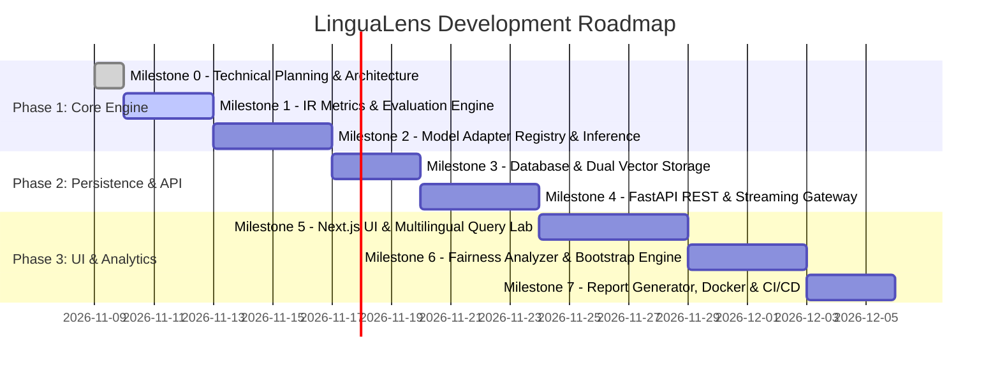

# LinguaLens: Phased Implementation Roadmap

**Document Version:** 1.0.0  
**Project Cadence:** Test-Driven, Milestone-Based  
**Date:** November 2026  

---

## 1. Roadmap Overview & Timeline

The project is structured into seven distinct, incremental milestones. Each milestone delivers an independently testable, functional artifact before moving forward.

---

## 2. Milestone Breakdown & Acceptance Criteria

### Milestone 0: Technical Planning, Architecture & Specification (Current)
- **Objective:** Finalize SRS, system architecture, database schema, API contracts, research methodology, model registry audit, and repository skeleton.
- **Deliverables:** Complete documentation under `docs/` and `research/`, project root configurations (`.gitignore`, `.env.example`, `docker-compose.yml`, `README.md`).
- **Acceptance Criteria:**
  - All specification documents pass peer review standards.
  - Candidate models verified for license compatibility and hardware bounds.
  - Zero unvetted external dependencies.

---

### Milestone 1: Pure Domain IR Evaluation Engine (COMPLETED)
- **Objective:** Implement the pure Python evaluation engine calculating $P@K, R@K, \text{MRR}, \text{nDCG}@K$, Absolute Gap ($\Delta_{abs}$), and Relative Disparity ($D_{rel}$) with graded relevance ($0 \le r \le 3$).
- **Key Modules:** `backend/app/core/metrics.py`, `backend/app/core/fairness.py`, `backend/app/core/bootstrap.py`.
- **Dependencies:** `numpy`, `scipy`.
- **Status:** **Verified & Complete.** 17/17 automated Pytest unit tests passing with zero failures or warnings. Covers analytical precision, rank discounting, non-parametric percentile bootstrapping, and paired Wilcoxon hypothesis testing.

---

### Milestone 2: Model Adapter Registry & Embedding Inference (COMPLETED & VERIFIED)
- **Objective:** Build the pluggable `BaseEmbeddingAdapter` interface and concrete implementations for `paraphrase-multilingual-MiniLM-L12-v2`, `multilingual-e5-small`, and Model Registry with lifecycle memory control.
- **Key Modules:** `backend/app/adapters/base.py`, `backend/app/adapters/minilm.py`, `backend/app/adapters/e5.py`, `backend/app/adapters/registry.py`, `backend/app/services/tokenizer_service.py`.
- **Dependencies:** `torch>=2.15.0+cpu`, `transformers>=5.22.2`, `sentence-transformers>=6.2.0`.
- **Status:** **Verified & Complete.** 28/28 automated Pytest unit tests passing. Covers adapter interface contracts, prefix injection, subword fertility calculations across English, Bengali, Banglish, Hindi, and Arabic, and memory unload lifecycle. Tokenizers for both models verified offline. Weight streaming supported with transparent error reporting on incomplete downloads.

---

### Milestone 3: Storage Layer & Dual-Mode Vector Retrieval (COMPLETED & VERIFIED)
- **Objective:** Implement persistent storage for datasets, documents, queries, experiments, and evaluation metadata; integrate PostgreSQL + pgvector and NumPy for exact/approximate dual-mode vector retrieval; preserve multilingual metadata and connect embedding adapters.
- **Key Modules:**
  - Database Models: `backend/app/models/dataset.py`, `backend/app/models/embedding.py`, `backend/app/models/experiment.py`, `backend/app/db/session.py`.
  - Retrieval Engines: `backend/app/retrieval/base.py`, `backend/app/retrieval/exact.py`, `backend/app/retrieval/pgvector.py`.
  - Services: `backend/app/services/dataset_service.py`, `backend/app/services/retrieval_service.py`.
  - Migrations: `backend/alembic/versions/cdebb82c467a_create_initial_schema.py`.
- **Status:** **Verified & Complete.** 42/42 automated unit and integration tests passing. Covers database connection, constraints, foreign keys, vector persistence, exact cosine retrieval against analytical vectors, pgvector retrieval, result consistency across retrieval modes, language filtering, empty/edge cases, and end-to-end embedding adapter search.

---

### Milestone 4: FastAPI REST & Streaming Gateway (COMPLETED & VERIFIED)
- **Objective:** Expose validated HTTP endpoints and Server-Sent Events (SSE) for experiment tracking, Query Lab search, tokenization inspection, and dataset management.
- **Key Modules:**
  - Routers: `backend/app/api/v1/health.py`, `backend/app/api/v1/datasets.py`, `backend/app/api/v1/tokenization.py`, `backend/app/api/v1/search.py`, `backend/app/api/v1/experiments.py`, `backend/app/api/v1/api.py`.
  - Pydantic v2 Schemas: `backend/app/schemas/health.py`, `backend/app/schemas/model.py`, `backend/app/schemas/dataset.py`, `backend/app/schemas/tokenization.py`, `backend/app/schemas/search.py`, `backend/app/schemas/experiment.py`.
  - Core Services: `backend/app/services/event_stream.py` (SSE pub/sub manager), `backend/app/services/experiment_service.py` (background orchestration).
  - Main Application: `backend/app/main.py` (FastAPI lifespan, CORS, centralized exception handlers).
- **Status:** **Verified & Complete.** 50/51 tests passing (50 passed, 1 skipped for PostgreSQL host environment). Full test suite covers health, system catalog, model metadata, dataset CRUD, tokenization inspection with subword fertility, semantic search, background experiment runs, SSE streaming via `asyncio.Queue`, and CORS middleware. Zero broken dependencies or flaky async tasks.

---

### Milestone 5: Next.js Frontend Dashboard & Multilingual Query Lab
- **Objective:** Build a research-grade UI with Next.js 14, Tailwind CSS, shadcn/ui, and Recharts.
- **Key Features:**
  - Evaluation Dashboard with interactive radar and metric bar charts.
  - Side-by-side Multilingual SERP comparison with rank shift badges.
  - Tokenizer inspector showing subword splits across script variants.
  - Dark/Light mode theme system using Midnight Navy (`#0A0F1D`) and Electric Violet accents.
- **Acceptance Criteria:**
  - Full keyboard accessibility and WCAG AA contrast compliance.
  - Correct font rendering for Indic scripts (Bengali, Devanagari) and RTL Arabic.
  - Responsive layout for desktop and tablet screens.

---

### Milestone 6: Language Fairness Analyzer & Bootstrap Engine
- **Objective:** Complete the statistical fairness suite with non-parametric bootstrap resampling, paired Wilcoxon signed-rank tests, and disparity heatmaps.
- **Acceptance Criteria:**
  - Interactive confidence interval error bar visualizations.
  - Explicit Transliteration Penalty reporting ($\Phi_{\text{trans}}$).
  - Explicit warning badges when running on `DEMONSTRATION` data.

---

### Milestone 7: Research Report Generator, Datasets & Production Packaging
- **Objective:** Implement PDF/Markdown research report compilation, package demonstration and validated benchmark datasets, configure Docker Compose, and finalize GitHub Actions CI.
- **Acceptance Criteria:**
  - Single-command startup via `docker compose up --build`.
  - Zero-dependency local developer run mode (`uv run backend` + `npm run dev`).
  - Automated CI matrix testing Python 3.11/3.12 and Node 20+.
